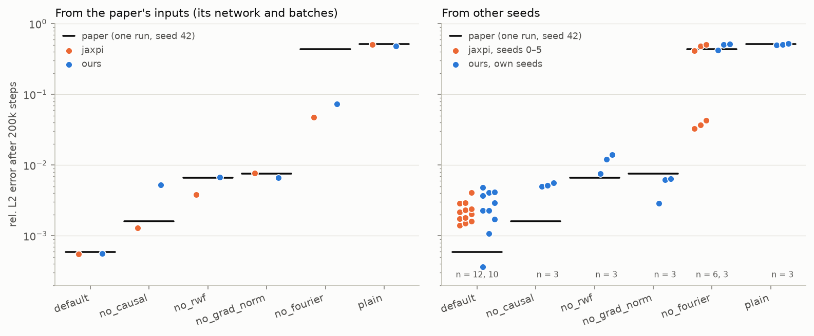

# piratenets-pytorch

An independent PyTorch reimplementation of the methods in two papers:

- **PirateNets: Physics-informed Deep Learning with Residual Adaptive Networks.**
  S. Wang, B. Li, Y. Chen, P. Perdikaris. *JMLR* 25 (2024). [arXiv:2402.00326](https://arxiv.org/abs/2402.00326)
- **An Expert's Guide to Training Physics-informed Neural Networks.**
  S. Wang, S. Sankaran, H. Wang, P. Perdikaris. 2023. [arXiv:2308.08468](https://arxiv.org/abs/2308.08468)

All credit for the methods belongs to the authors. This code is not affiliated
with them and contains no code from their JAX implementation
([jaxpi](https://github.com/PredictiveIntelligenceLab/jaxpi)). The method is
implemented from the papers. Where the papers leave a hyperparameter or design
detail open, jaxpi's example configs and code were consulted for that detail
only. Every such choice is recorded, with its source, in
[`docs/decisions.md`](docs/decisions.md).

It is a course project for CEE 292 at Stanford. Its goal is to reproduce the
Allen–Cahn ablation of the Expert's Guide (its Table 2).

## Results

Given the paper's own starting network and batch sequence, this code reproduces
Table 2. Four of the six rows end within 0.89–1.01× of the paper's values. The
other two, `no_causal` and `no_fourier`, are rows where a single run can end in
one of two ways. On `no_fourier`, jaxpi's own run from the same inputs also ends
far from the paper's value.

From other seeds, the full pipeline (`default`) ends several times above the
paper's 5.84e-4, and so does jaxpi. The paper's values are single runs from a
favorable seed (42). From seeds 0–5, jaxpi ends at a median of 2.1e-3, and from
the same starting networks this code ends where jaxpi does.



Every run and test behind this is in [`docs/results.md`](docs/results.md).

## Status

| Component | Status |
|---|---|
| Allen–Cahn problem, reference data, exact periodic embedding | done |
| Random Fourier features, random weight factorization | done |
| Grad-norm loss weighting, causal weighting | done |
| Expert's Guide Table 2 ablation configs and runner | done, results in [`docs/results.md`](docs/results.md) |
| Modified MLP, PirateNet + physics-informed init, NTK weighting | not implemented (Table 2 does not use them) |

## Install

```bash
pip install -e ".[dev]"
pytest -q
```

The distribution and import name are both `piratenets`.

## Usage

```bash
# one configuration (resumes automatically from <out_dir>/checkpoints/last.pt)
python scripts/train.py --config configs/allen_cahn/ablation/default.yaml

# the whole ablation (Expert's Guide Table 2), skipping finished rows
python scripts/run_ablation.py --out-root runs/allen_cahn/ablation

# figures and the comparison table, from the CSV logs
python scripts/plot_ablation.py --out-root runs/allen_cahn/ablation
python scripts/plot_run.py runs/allen_cahn/ablation/ablation_default

# Table 2 as distributions over runs (docs/table2.png)
python scripts/plot_table2.py
```

Any config value can be overridden from the command line, for example
`--set training.steps=2000 causal.num_chunks=16`.

To run on a Colab GPU, with checkpoints and logs saved to Google Drive, use
[`notebooks/colab_ablation.ipynb`](notebooks/colab_ablation.ipynb)
([open in Colab](https://colab.research.google.com/github/maanpandya/piratenets-pytorch/blob/main/notebooks/colab_ablation.ipynb)).

## Layout

```
piratenets/            config, embeddings, layers (RWF), models, weighting, causal, trainer
piratenets/problems/   allen_cahn.py: PDE residual, sampling, reference data
configs/               one YAML per experiment (one per Table 2 row)
scripts/               train, run_ablation, benchmark_step, plot_*
data/                  reference solution and its generator
docs/                  spec.md, decisions.md, results.md
tests/                 pytest suite
```

## License

MIT, see [LICENSE](LICENSE). The papers themselves are not included in this repository.
