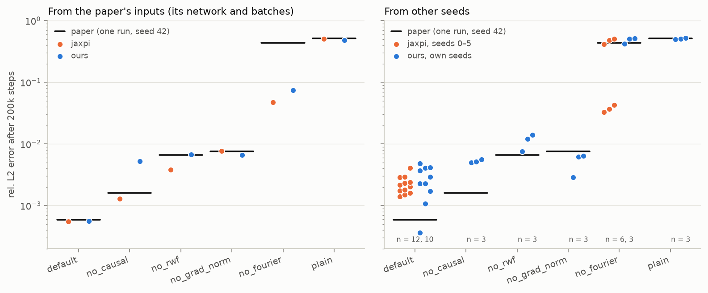

# Results: the Expert's Guide Allen–Cahn ablation (Table 2)

Table 2 of the Expert's Guide (arXiv:2308.08468) ablates its training pipeline on the 1D Allen–Cahn
equation. Each row turns off one component and reports the relative L2 error after training. This page
compares this implementation with that table. Every run here is 200k steps in float32 with TF32 off, on one
RTX 3070 Ti Laptop GPU.

## Summary

- **Given the paper's own starting network and batches, this code reproduces Table 2.** Four of the six rows
  end within 0.89–1.01× of the paper. In the other two, `no_causal` and `no_fourier`, a single run can end
  in one of two ways. On `no_fourier`, the authors' code (jaxpi), given the same inputs, also departs from
  the paper's value.
- **From other seeds, `default` ends 4.5× above the paper by median, and so does the authors' code.** The
  paper's values are single runs from seed 42, which turns out to be a favorable seed. jaxpi's `default`
  from seeds 0–5 ends at a median of 2.1e-3, 3.6× the paper. Ours, over ten seeds, ends at 2.6e-3, and the
  two sets of runs cannot be told apart (Mann–Whitney p = 0.34).
- **The final error is sensitive to the seed** because it sits at x = 0, where small errors grow like
  e^{5t}. From one starting network, the batch sequence alone changed the final error tenfold.

Final rel. L2 of each row after 200k steps. Left: from the paper's own starting network and batch sequence.
Right: from other seeds, jaxpi's (seeds 0–5; for `default` on two batch sequences each) and ours. The
black tick is the paper's single run, and n gives the number of runs in each strip, left to right.
`scripts/plot_table2.py` draws it.

## Table 2 from the paper's inputs

The authors logged their Table 2 runs publicly on Weights & Biases (project `jaxpi/allen_cahn`). All six
start from jaxpi's seed 42, and since jaxpi's residual sampler uses a fixed key, they all train on one batch
sequence. We exported each row's starting network and that batch sequence from jaxpi, then trained this
implementation on them for all 200k steps. These runs repeat the paper's experiment in this code, free of
the luck of the seed.

| Row | Fourier | RWF | Grad norm | Causal | Paper | jaxpi, same inputs | Ours, same inputs | Ours / paper |
|---|:-:|:-:|:-:|:-:|--:|--:|--:|--:|
| `default` | ✓ | ✓ | ✓ | ✓ | 5.84e-4 | 5.52e-4 | 5.56e-4 | 0.95 |
| `no_causal` | ✓ | ✓ | ✓ | | 1.59e-3 | 1.29e-3 | 5.26e-3 | 3.31 |
| `no_rwf` | ✓ | | ✓ | ✓ | 6.62e-3 | 3.83e-3 | 6.72e-3 | 1.01 |
| `no_grad_norm` | ✓ | ✓ | | ✓ | 7.51e-3 | 7.72e-3 | 6.66e-3 | 0.89 |
| `no_fourier` | | ✓ | ✓ | ✓ | 4.35e-1 | 4.74e-2 | 7.37e-2 | 0.17 |
| `plain` | | | | | 5.17e-1 | 5.03e-1 | 4.85e-1 | 0.94 |

- **`default`, `no_rwf`, `no_grad_norm` and `plain` follow the paper's runs** throughout training. `default`
  reaches 9.4e-4 at 100k steps, the same value as jaxpi's run from the same inputs. Even from the same
  inputs, round-off makes runs drift apart late in training: jaxpi's own `no_rwf` ends 1.7× below the
  paper's.
- **`no_causal` ends high after one setback.** Ours follows the paper's run until 19.7k steps. Then a single
  burst in the losses throws it back to the early plateau, and it stays behind to the end. jaxpi falls back
  too: from the same network, on ten other batch sequences, jaxpi fell back in 1 of 10 runs of 30k steps
  and this code in 3 of 11 (Fisher p = 0.33).
- **`no_fourier` has two outcomes.** A run either stays at a wrong solution (rel. L2 0.4–0.5), as the paper's
  run did, or escapes to the right one (0.03–0.08). jaxpi's run from the paper's exact inputs escapes, as
  ours does. Over all runs of this row, jaxpi escapes in 4 of 7 and this code in 8 of 14, to the same levels
  (Mann–Whitney p = 0.28). This row amplifies round-off quickly: our own CPU and GPU runs from the same
  inputs are 28% apart within 300 steps.

## Table 2 from other seeds

| Row | Seeds 0, 1, 2 | Median | Paper | Median / paper |
|---|---|--:|--:|--:|
| `default` | 2.93e-3, 2.27e-3, 2.27e-3 | 2.60e-3 (10 seeds) | 5.84e-4 | 4.5 |
| `no_causal` | 5.61e-3, 4.95e-3, 5.16e-3 | 5.16e-3 | 1.59e-3 | 3.2 |
| `no_rwf` | 1.39e-2, 1.20e-2, 7.60e-3 | 1.20e-2 | 6.62e-3 | 1.8 |
| `no_grad_norm` | 2.86e-3, 6.41e-3, 6.14e-3 | 6.14e-3 | 7.51e-3 | 0.82 |
| `no_fourier` | 5.12e-1, 5.06e-1, 4.24e-1 | 5.06e-1 | 4.35e-1 | 1.2 |
| `plain` | 5.25e-1, 4.94e-1, 5.08e-1 | 5.08e-1 | 5.17e-1 | 0.98 |

`default` seeds 3–9 end at 3.67e-3, 4.81e-3, 1.07e-3, 3.64e-4, 1.72e-3, 4.14e-3 and 4.09e-3; seed 6 ends
below the paper. By median the rows rank as the paper's do, except that `no_rwf` and `no_grad_norm`, within
15% of each other in the paper, swap places.

**The paper's seed is favorable.** jaxpi's own `default`, run unmodified, reproduces the paper from seed 42
(5.52e-4). From seeds 0–5 it ends at 1.39–4.05e-3 instead, with a median of 2.09e-3 over 12 runs (each seed
on two batch sequences). Our ten seeds have a geometric mean of 2.23e-3 against jaxpi's 2.13e-3 (1.05×,
Mann–Whitney p = 0.34).

**Given the same inputs, the two trainers agree.** From the same network and batch, their losses agree to 8
digits and their loss weights to 6 after one update. Over whole runs from jaxpi's starting networks, on
jaxpi's batches:

| jaxpi's starting network | jaxpi | Ours | Ours / jaxpi |
|---|--:|--:|--:|
| seed 42 | 5.52e-4 | 5.56e-4 | 1.01 |
| seed 0 | 1.51e-3 | 1.53e-3 | 1.01 |
| seed 1 | 1.39e-3 | 1.09e-3 | 0.78 |
| seed 2 | 1.73e-3 | 1.77e-3 | 1.02 |
| seed 3 | 2.89e-3 | 3.12e-3 | 1.08 |
| seed 4 | 2.03e-3 | 2.29e-3 | 1.13 |
| seed 5 | 4.05e-3 | 1.61e-3 | 0.40 |

Five of the seven end within 13% of jaxpi's run. The other two follow it for 50k steps, then part from
round-off. On batches drawn by our own sampler, from the same six networks, 12 runs average 2.01e-3, the
same as the 18 runs on jaxpi's batches. Our initial networks match jaxpi's layer by layer, in weight scale
and in the RWF scales.

**The spread is large.** From batches and round-off alone, two runs from the same starting network can end
ten times apart: our seed-4 network ends at 4.81e-3 on its own batch sequence and at 4.53e-4 on another.
Single runs, like the paper's, should be read with that in mind.

## Where the error comes from

In every converged run checked, from both codes, the error sits at x = 0 late in time: at t = 1, over 99%
of the squared error lies within |x| < 0.1. The initial condition u₀ = x² cos(πx) has a double zero at
x = 0, so the solution starts at the unstable state u = 0 there. Any error grows like e^{5t}, while the PDE
residual barely registers it. So the final error is set by how well a run holds u ≈ 0 near x = 0 early on,
amplified about 100×. That is why runs with the same losses can end several times apart.
`scripts/error_location.py` reports this for any finished run.

## Reproducing these runs

- **Our own seeds:** `python scripts/run_ablation.py --set training.seed=N --out-root runs/allen_cahn/seedN`,
  then `python scripts/plot_table2.py` to redraw the figure with them.
- **The same-input runs** start from networks and a batch sequence exported from jaxpi. These are not part
  of this repository (the batch sequence alone is 6.5 GB); their results are listed in
  `scripts/plot_table2.py`.
